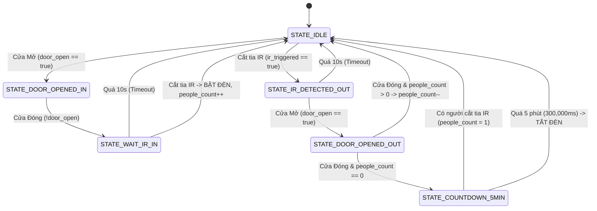
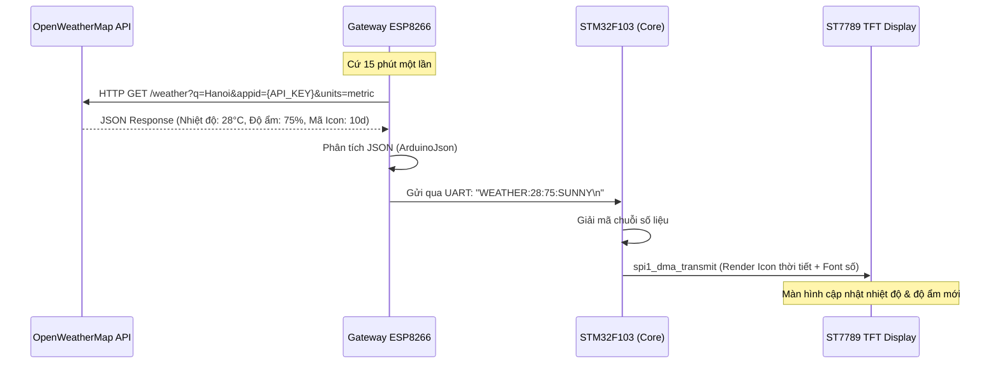
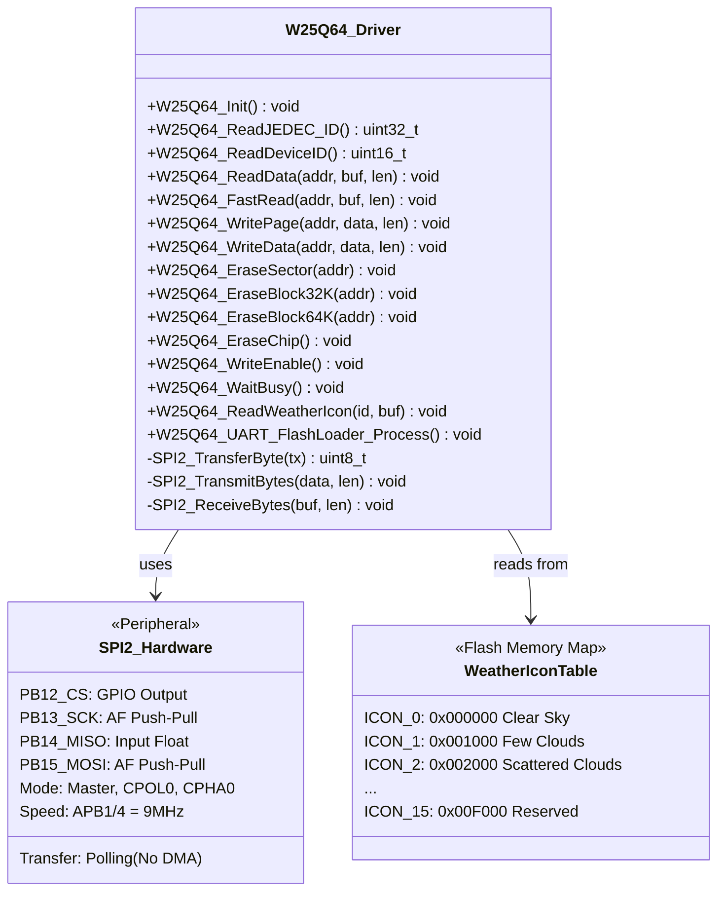
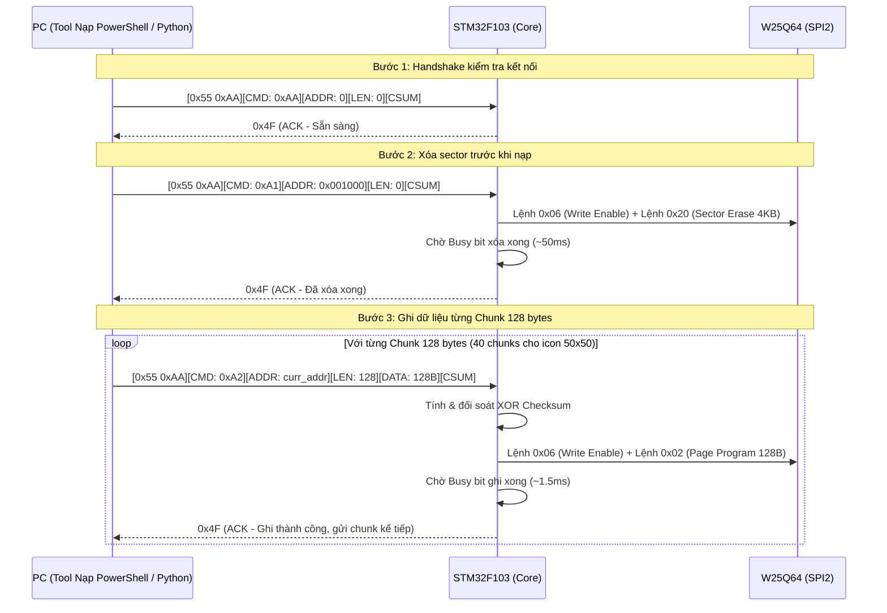

# 🏠 TỔNG QUAN HỆ THỐNG NHÀ THÔNG MINH IOT (SHA - SMART HOME AUTOMATION)
> **Phiên bản tài liệu:** v2.0  
> **Kiến trúc phần cứng:** STM32F103C8T6 (Blue Pill) + ESP8266 (Wi-Fi Gateway) + Module Cảm Biến Ra Vào + ST7789 TFT LCD + W25Q64 SPI Flash + Module Relay  
> **Giao thức mạng:** MQTT (Bản tin JSON / Text Command) qua Wi-Fi  
> **Mục tiêu tài liệu:** Tổng hợp toàn diện thiết kế kiến trúc phần cứng, phần mềm, luồng FSM, giao thức UART DMA và **KẾ HOẠCH NÂNG CẤP HỆ THỐNG LÊN 4 RELAY**.

---

## 📑 MỤC LỤC
1. [Giới Thiệu Chung & Bối Cảnh Dự Án](#1-giới-thiệu-chung--bối-cảnh-dự-án)
2. [Sơ Đồ Kiến Trúc Hệ Thống](#2-sơ-đồ-kiến-trúc-hệ-thống)
3. [Hiện Trạng Phần Cứng & Phân Bổ Chân (Pinout Mapping)](#3-hiện-trạng-phần-cứng--phân-bổ-chân-pinout-mapping)
4. [Phân Tích Chi Tiết Khối Phần Mềm Hiện Tại](#4-phân-tích-chi-tiết-khối-phần-mềm-hiện-tại)
   - [4.1. Máy Trạng Thái Hữu Hạn (FSM) Đếm Người & Tự Động Bật/Tắt](#41-máy-trạng-thái-hữu-hạn-fsm-đếm-người--tự-động-bậttắt)
   - [4.2. Khối Giao Tiếp UART1 DMA Bất Đồng Bộ (STM32 ↔ ESP8266)](#42-khối-giao-tiếp-uart1-dma-bất-đồng-bộ-stm32--esp8266)
   - [4.3. Khối Hiển Thị ST7789 SPI1 DMA](#43-khối-hiển-thị-st7789-spi1-dma)
   - [4.4. Khối Gateway ESP8266 & MQTT](#44-khối-gateway-esp8266--mqtt)
5. [NÂNG CẤP: KẾ HOẠCH NÂNG CẤP ĐIỀU KHIỂN 4 RELAY](#5-nâng-cấp-kế-hoạch-nâng-cấp-điều-khiển-4-relay)
   - [5.1. Phân Tích & Lựa Chọn Chân GPIO Tối Ưu Cho 4 Relay](#51-phân-tích--lựa-chọn-chân-gpio-tối-ưu-cho-4-relay)
   - [5.2. Sơ Đồ Đấu Nối Mạch Phần Cứng 4 Relay Cách Ly An Toàn](#52-sơ-đồ-đấu-nối-mạch-phần-cứng-4-relay-cách-ly-an-toàn)
   - [5.3. Chuẩn Hóa Giao Thức Truyền Thông Mới (UART & MQTT)](#53-chuẩn-hóa-giao-thức-truyền-thông-mới-uart--mqtt)
   - [5.4. Thiết Kế Mã Nguồn Mẫu (Tham Khảo Nâng Cấp - Không Sửa Trực Tiếp Vào File Gốc)](#54-thiết-kế-mã-nguồn-mẫu-tham-khảo-nâng-cấp---không-sửa-trực-tiếp-vào-file-gốc)
6. [Tích Hợp API Thời Tiết & Giao Diện Hiển Thị ST7789](#6-tích-hợp-api-thời-tiết--giao-diện-hiển-thị-st7789)
7. [Khối Lưu Trữ Flash W25Q64 – SPI2 Driver & Quản Lý Asset (Icon & Font)](#7-khối-lưu-trữ-flash-w25q64--spi2-driver--quản-lý-asset-icon--font)
   - [7.1. Tổng Quan & Lý Do Chọn W25Q64](#71-tổng-quan--lý-do-chọn-w25q64)
   - [7.2. Kết Nối Phần Cứng SPI2](#72-kết-nối-phần-cứng-spi2)
   - [7.3. Bản Đồ DMA1 – Phân Tích Xung Đột & Giải Pháp](#73-bản-đồ-dma1--phân-tích-xung-đột--giải-pháp)
   - [7.4. Kiến Trúc Driver W25Q64](#74-kiến-trúc-driver-w25q64)
   - [7.5. Bảng Phân Vùng Bộ Nhớ Trong Flash (Sector-Aligned Memory Map)](#75-bảng-phân-vùng-bộ-nhớ-trong-flash-sector-aligned-memory-map)
   - [7.6. Cơ Chế Nạp Chunk 128 Bytes & Giao Thức Stop-and-Wait](#76-cơ-chế-nạp-chunk-128-bytes--giao-thức-stop-and-wait)
   - [7.7. Công Cụ Nạp Tự Động (PowerShell & Python Flash Loaders)](#77-công-cụ-nạp-tự-động-powershell--python-flash-loaders)
   - [7.8. Stream Dữ Liệu Trực Tiếp Ra LCD ST7789 (Siêu Tiết Kiệm RAM)](#78-stream-dữ-liệu-trực-tiếp-ra-lcd-st7789-siêu-tiết-kiệm-ram)
   - [7.9. Khắc Phục Lỗi Biên Dịch & LVGL Shim Layer](#79-khắc-phục-lỗi-biên-dịch--lvgl-shim-layer)
8. [Bảng Kiểm Tra & Hướng Dẫn Vận Hành Hệ Thống](#8-bảng-kiểm-tra--hướng-dẫn-vận-hành-hệ-thống)

---

## 1. Giới Thiệu Chung & Bối Cảnh Dự Án

Dự án **SHA (Smart Home Automation)** là một hệ thống nhúng IoT biên (Edge Computing) kết hợp giữa khả năng xử lý thời gian thực, điều khiển thanh ghi tốc độ cao của vi điều khiển **STM32F103C8T6 (ARM Cortex-M3)** và khả năng kết nối không dây của vi điều khiển **ESP8266**.

### Các Tính Năng Cốt Lõi:
- **Tự động hóa thông minh (Smart Automation):** Sử dụng cặp cảm biến cửa từ (Door Reed Switch) và cảm biến hồng ngoại (IR Sensor) phối hợp với mô hình Máy trạng thái hữu hạn (**FSM**) để xác định chính xác hành vi vào/ra nhà của con người.
- **Tiết kiệm năng lượng:** Tự động bật thiết bị khi có người bước vào nhà; đếm ngược 5 phút tự động ngắt điện khi toàn bộ người đã rời khỏi nhà.
- **Điều khiển & Giám sát từ xa qua MQTT:** Kết nối qua Wi-Fi tới MQTT Broker (`test.mosquitto.org`), cho phép giám sát số lượng người trong phòng và điều khiển thiết bị thông qua điện thoại/dashboard.
- **Màn hình hiển thị màu ST7789 (IPS 240x240):** Giao tiếp qua SPI1 kết hợp kênh DMA1 Channel 3, vẽ đồ họa mượt mà, sẵn sàng hiển thị thông số môi trường và API thời tiết.
- **Hiện trạng:** Hệ thống đang điều khiển **1 kênh Relay** qua lệnh văn bản đơn giản (`ON` / `OFF`).
- **Nhu cầu cấp thiết:** **NÂNG CẤP** mở rộng điều khiển độc lập **4 Relay**, quy hoạch lại chân GPIO tối ưu, chuẩn hóa gói tin UART/MQTT và tích hợp hiển thị thời tiết.

---

## 2. Sơ Đồ Kiến Trúc Hệ Thống

```mermaid
flowchart TD
    subgraph SENSORS ["Khối Cảm Biến Nhận Diện"]
        S_DOOR["Cảm biến cửa từ (PA0 / EXTI0)"]
        S_IR["Cảm biến hồng ngoại IR (PA1 / EXTI1)"]
    end

    subgraph MCU_STM32 ["Bộ Xử Lý Trung Tâm: STM32F103C8T6 (72MHz)"]
        FSM["Bộ Phân Tích Chiều Ra/Vào (FSM Core)"]
        UART_DMA["UART1 + DMA1 Ch4/Ch5 Ring Buffer"]
        SPI_DMA["SPI1 + DMA1 Ch3 Display Driver"]
        SPI2_FLASH["SPI2 Polling - W25Q64 Flash Driver"]
        RELAY_CORE["Relay Driver Controller"]
        SYSTICK["SysTick Timer (1ms Timebase)"]
    end

    subgraph GATEWAY_ESP ["Khối Kết Nối Mạng: ESP8266"]
        WIFI_MGR["WiFiManager (Web Config Portal)"]
        MQTT_CLIENT["PubSubClient (MQTT Protocol)"]
        WEATHER_TASK["OpenWeatherMap API Fetcher"]
    end

    subgraph CLOUD_UI ["Hạ Tầng Đám Mây & Người Dùng"]
        BROKER["MQTT Broker: test.mosquitto.org"]
        DASHBOARD["App Mobile / Web Dashboard"]
        OPENWEATHER["OpenWeatherMap REST API"]
    end

    subgraph ACTUATORS ["Khối Chấp Hành & Hiển Thị"]
        LCD_TFT["ST7789 IPS 240x240 (SPI1)"]
        FLASH_W25Q["W25Q64 SPI Flash 8MB (SPI2)"]
        RELAYS["Module 4 Relay (Đèn, Quạt, Ổ Cắm, Bình Nước)"]
        LED_STATUS["LED Báo Trạng Thái (PC13)"]
    end

    %% Luồng tín hiệu
    S_DOOR -->|Ngắt cạnh xuống| FSM
    S_IR -->|Ngắt 2 cạnh| FSM
    SYSTICK -.->|1ms Tick| FSM

    FSM -->|Cập nhật trạng thái| RELAY_CORE
    FSM -->|Thay đổi People Count| UART_DMA

    RELAY_CORE -->|Tín hiệu logic| RELAYS
    RELAY_CORE -.->|Cờ flag_relay_changed| UART_DMA

    SPI2_FLASH -->|Đọc icon RGB565| SPI_DMA
    SPI2_FLASH <-->|SPI2 Polling (PB12-PB15)| FLASH_W25Q

    UART_DMA <==>|UART1 115200 bps Full-Duplex| GATEWAY_ESP
    SPI_DMA -->|Dữ liệu màu RGB565| LCD_TFT

    GATEWAY_ESP <==>|Wi-Fi 2.4GHz TCP/IP| BROKER
    BROKER <==>|Publish / Subscribe Topics| DASHBOARD
    GATEWAY_ESP <==>|HTTP GET Request| OPENWEATHER
```

---

## 3. Hiện Trạng Phần Cứng & Phân Bổ Chân (Pinout Mapping)

Vi điều khiển **STM32F103C8T6** có 48 chân (gói LQFP48). Bảng dưới đây mô tả chính xác hiện trạng các chân GPIO đang được sử dụng trong codebase hiện tại:

| Chân STM32 | Chức Năng Cấu Hình | Hướng (I/O) | Cấu Hình Thanh Ghi (CRL / CRH) | Thiết Bị Kết Nối | Ghi Chú & Đặc Điểm |
| :--- | :--- | :---: | :--- | :--- | :--- |
| **PA0** | EXTI Line 0 | INPUT | Input with Pull-up (ODR = 1) | Cảm biến Cửa (Magnetic Reed / Button) | Ngắt cạnh xuống, lọc rung phần mềm 200ms |
| **PA1** | EXTI Line 1 | INPUT | Input with Pull-up (ODR = 1) | Cảm biến Hồng Ngoại (IR Sensor) | Ngắt cả 2 cạnh (Falling + Rising) |
| **PA2** | GPIO Output | OUTPUT | Output Push-Pull 50MHz (`0x3`) | ST7789 **RES** (Reset) | Điều khiển chân Reset phần cứng màn hình |
| **PA3** | GPIO Output | OUTPUT | Output Push-Pull 50MHz (`0x3`) | ST7789 **DC** (Data / Command) | Mức 0: Lệnh, Mức 1: Dữ liệu màn hình |
| **PA4** | GPIO Output | OUTPUT | Output Push-Pull 50MHz (`0x3`) | ST7789 **CS** (Chip Select) | Chọn chip SPI cho màn hình LCD |
| **PA5** | SPI1_SCK | OUTPUT | Alternate Function Push-Pull (`0xB`) | ST7789 **SCL** (Clock) | Xung nhịp SPI phần cứng (tối đa 36MHz) |
| **PA6** | Trống | - | Mặc định (Floating Input) | *(Tùy chọn: SPI1 MISO / Flash W25Q64)* | Chưa dùng trong code chính |
| **PA7** | SPI1_MOSI | OUTPUT | Alternate Function Push-Pull (`0xB`) | ST7789 **SDA** (Master Out) | Truyền dữ liệu Pixel/Command qua DMA1 Ch3 |
| **PA8** | GPIO Output | OUTPUT | Output Push-Pull 2MHz (`0x2`) | **RELAY HIỆN TẠI (1 Kênh)** | Mức 1: Bật Relay, Mức 0: Tắt Relay |
| **PA9** | USART1_TX | OUTPUT | Alternate Function Push-Pull (`0xB`) | Kết nối tới chân **RXD** của ESP8266 | Baudrate 115200, truyền qua DMA1 Ch4 |
| **PA10** | USART1_RX | INPUT | Input Floating (`0x4`) | Kết nối tới chân **TXD** của ESP8266 | Baudrate 115200, nhận qua DMA1 Ch5 Circular |
| **PA13** | SWDIO | IN/OUT | Debug JTAG/SWD | Nạp code ST-Link V2 | **CẤM DÙNG** làm GPIO thường |
| **PA14** | SWCLK | INPUT | Debug JTAG/SWD | Nạp code ST-Link V2 | **CẤM DÙNG** làm GPIO thường |
| **PB0** | GPIO Output | OUTPUT | Output Push-Pull 50MHz (`0x3`) | ST7789 **BLK** (Backlight) | Đèn nền màn hình (1: Bật, 0: Tắt) |
| **PB12** | GPIO Output (CS) | OUTPUT | Output Push-Pull 50MHz (`0x3`) | W25Q64 **CS** (Chip Select) | Software NSS điều khiển Flash SPI |
| **PB13** | SPI2_SCK | OUTPUT | AF Output Push-Pull (`0xB`) | W25Q64 **CLK** (Clock) | Xung nhịp SPI2 (9MHz = APB1/4) |
| **PB14** | SPI2_MISO | INPUT | Input Floating (`0x4`) | W25Q64 **DO** (Data Out) | Nhận dữ liệu từ Flash |
| **PB15** | SPI2_MOSI | OUTPUT | AF Output Push-Pull (`0xB`) | W25Q64 **DI** (Data In) | Truyền dữ liệu sang Flash |
| **PC13** | GPIO Output | OUTPUT | Output Push-Pull 2MHz (`0x3`) | On-board User LED | Đèn LED xanh trên mạch Blue Pill (Active LOW) |

---

## 4. Phân Tích Chi Tiết Khối Phần Mềm Hiện Tại

### 4.1. Máy Trạng Thái Hữu Hạn (FSM) Đếm Người & Tự Động Bật/Tắt

Mã nguồn trong [fsm.c](file:///c:/New%20folder/SHA_README/SHA/Src/fsm.c) cài đặt một FSM thông minh để nhận biết người **ĐI VÀO** hoặc **ĐI RA** dựa trên thứ tự tác động giữa Cảm biến Cửa và Cảm biến IR:



- **Quy tắc đếm người vào:** Cửa mở &rarr; Cửa đóng &rarr; Trong vòng 10 giây cắt tia IR &rarr; Xác nhận có người vào nhà: `people_count++`, tự động gọi `relay_set_state(RELAY_ON)`.
- **Quy tắc đếm người ra:** Cắt tia IR &rarr; Trong vòng 10 giây mở cửa &rarr; Cửa đóng lại &rarr; Xác nhận có người rời nhà: `people_count--`.
- **Chế độ tự ngắt an toàn:** Khi số người giảm về `0`, hệ thống kích hoạt bộ hẹn giờ 5 phút (`COUNTDOWN_5MIN_MS = 300000`). Nếu trong 5 phút này chủ nhà quay lại cắt tia IR, số lượng được khôi phục về `1`; nếu hết 5 phút không có chuyển động, hệ thống ngắt toàn bộ điện phòng: `relay_set_state(RELAY_OFF)`.

---

### 4.2. Khối Giao Tiếp UART1 DMA Bất Đồng Bộ (STM32 &harr; ESP8266)

Tại [uart.c](file:///c:/New%20folder/SHA_README/SHA/Src/uart.c), UART1 được thiết kế với cấu trúc chống nghẽn CPU tuyệt đối bằng cách khai thác **DMA1**:
1. **Chiều nhận (RX - DMA1 Channel 5):**
   - Hoạt động ở chế độ **Circular (Vòng lặp)** với buffer kích thước 256 byte (`rx_ring_buffer`).
   - Sử dụng cơ chế phát hiện dữ liệu phần cứng trực tiếp:
     $$\text{head\_ptr} = \text{RX\_RING\_SIZE} - \text{DMA1\_Channel5}\rightarrow\text{CNDTR}$$
   - Hàm `UART1_Get_Rx_Buffer()` tích hợp **bộ lọc chống nhiễu** loại bỏ hoàn toàn các byte Null (`0x00`) và byte rác (`0xFF`), áp dụng kỹ thuật **Sliding Window** để ghép chuỗi lệnh chuẩn hóa.
2. **Chiều truyền (TX - DMA1 Channel 4):**
   - Truyền dữ liệu hoàn toàn bằng DMA (`UART1_DMA_Transmit`).
   - CPU không phải đợi từng ký tự, giải phóng tài nguyên xử lý FSM và đồ họa.

---

### 4.3. Khối Hiển Thị ST7789 SPI1 DMA

Tại [spi1_lcd_st7789.c](file:///c:/New%20folder/SHA_README/SHA/Src/spi1_lcd_st7789.c):
- Giao thức SPI1 Master tốc độ cao kết hợp với **DMA1 Channel 3** (Memory to Peripheral, 8-bit).
- Hỗ trợ khoanh vùng hiển thị nhanh (`ST7789_SetWindow`), xóa toàn màn hình với màu bất kỳ (`ST7789_FillColor`) và hiển thị ảnh Bitmap RGB565 theo từng khối Chunk 65000 byte không làm tràn thanh ghi DMA.

---

### 4.4. Khối Gateway ESP8266 & MQTT

Tại [esp8266test.md](file:///c:/New%20folder/SHA_README/SHA/esp8266test.md), ESP8266 đảm nhận vai trò cầu nối:
- **Cấu hình mạng linh hoạt:** Sử dụng thư viện `WiFiManager`. Khi khởi động lần đầu hoặc mất mạng, ESP phát ra Access Point `IoT_Product_Setup` để người dùng kết nối điện thoại vào cấu hình mật khẩu Wi-Fi mà không cần nạp lại code.
- **Kết nối MQTT:** Kết nối tới Broker `test.mosquitto.org:1883`.
  - Đăng ký nhận lệnh (Subscribe): `bk_phu/lab/commands`
  - Báo cáo trạng thái Relay (Publish): `bk_phu/lab/status`
  - Báo cáo số lượng người (Publish): `bk_phu/lab/count`
- **Bộ chuyển đổi tập lệnh:**
  - Lệnh MQTT `"ON"` &rarr; UART đẩy `CMD:ON\n` sang STM32.
  - Lệnh MQTT `"OFF"` &rarr; UART đẩy `CMD:OFF\n` sang STM32.
  - Lệnh MQTT `"SET_CNT:x"` &rarr; UART đẩy `CMD:SET_CNT:x\n` sang STM32.
  - Nhận UART `STS:ON\n` &rarr; Publish lên MQTT `"ON"`.
  - Nhận UART `STS:OFF\n` &rarr; Publish lên MQTT `"OFF"`.
  - Nhận UART `STS:CNT:x\n` &rarr; Publish lên MQTT `x`.

---

## 5. NÂNG CẤP: KẾ HOẠCH NÂNG CẤP ĐIỀU KHIỂN 4 RELAY

> [!IMPORTANT]
> **YÊU CẦU NÂNG CẤP CỐT LÕI:**
> 1. Mở rộng từ điều khiển **1 Relay** (chỉ có 2 trạng thái ON/OFF chung) thành **4 Relay độc lập**.
> 2. Lựa chọn các chân GPIO trên STM32F103C8T6 chính xác, an toàn, không gây xung đột với các ngoại vi hiện hữu (SPI1, UART1, EXTI, SWD).
> 3. Chuẩn hóa giao thức truyền thông giữa STM32 và ESP8266 cũng như cấu trúc Topic trên MQTT Broker.
> 4. Cung cấp thiết kế mã nguồn nâng cấp chi tiết, tách biệt rõ ràng dưới dạng tài liệu kỹ thuật *(nghiêm ngặt tuân thủ quy tắc không can thiệp trực tiếp vào file mã nguồn `.c` hiện có)*.

---

### 5.1. Phân Tích & Lựa Chọn Chân GPIO Tối Ưu Cho 4 Relay

Khi nâng cấp lên 4 Relay, chúng ta cần chọn 4 chân GPIO thỏa mãn đồng thời các tiêu chí kỹ thuật:
1. **Không xung đột ngoại vi đã dùng:** Loại trừ PA0..PA5, PA7 (Cảm biến & Màn hình ST7789), PA9..PA10 (UART1 ESP8266), PB0 (Đèn nền LCD), PC13 (LED báo trạng thái).
2. **Không chạm vào chân nạp/debug:** Tuyệt đối tránh PA13 (SWDIO) và PA14 (SWCLK).
3. **Dễ dàng đi dây cơ khí:** Các chân nên nằm liên tiếp trên bo mạch để người dùng có thể cắm trực tiếp cáp bẹ 4 dây (Dupont ribbon cable) từ STM32 sang Module 4 Relay.
4. **Điện áp và khả năng chịu tải (5V Tolerant):** Module Relay thường sử dụng mức logic 5V hoặc optocoupler kéo lên 5V.

#### 🎯 BẢNG SO SÁNH CÁC PHƯƠNG ÁN LỰA CHỌN CHÂN:

| Phương Án | Danh Sách Chân | Ưu Điểm | Nhược Điểm | Đánh Giá |
| :--- | :--- | :--- | :--- | :---: |
| **Phương Án 1 (KHUYÊN DÙNG)** | **PB12, PB13, PB14, PB15** | • **4 chân liên tiếp nhau** trên hàng chân bo mạch Blue Pill.<br>• Thuộc cùng thanh ghi `GPIOB->CRH` (Bits 16&ndash;31), thao tác bitmask cực kỳ nhanh và gọn.<br>• Đều là chân chịu được 5V (**5V-Tolerant**).<br>• Không ảnh hưởng đến bất kỳ ngoại vi nào khác.<br>• Giải phóng chân PA8 cho mục đích khác hoặc làm chân dự phòng. | Phải cắm lại dây của Relay 1 hiện tại sang PB12. | ⭐⭐⭐⭐⭐ **(Tối ưu nhất về cả phần cứng lẫn phần mềm)** |
| **Phương Án 2 (Kế thừa PA8)** | **PA8, PB12, PB13, PB14** | • Giữ nguyên dây cắm hiện tại của Relay 1 trên chân PA8.<br>• Thêm 3 chân PB12, PB13, PB14 cho Relay 2, 3, 4. | • Chân bị xé lẻ giữa Port A và Port B.<br>• Trong mã nguồn phải cấu hình cả `GPIOA->CRH` và `GPIOB->CRH`.<br>• Cáp cắm từ STM32 sang module relay bị tách lẻ, đi dây luộm thuộm. | ⭐⭐⭐⭐ (Phù hợp nếu không muốn rút dây PA8) |

#### 📌 CHỌN LỰA CUỐI CÙNG: **PHƯƠNG ÁN 1 (PB12, PB13, PB14, PB15)**
*(Trường hợp bạn muốn giữ chân PA8 cho Relay 1, hệ thống mã nguồn mẫu dưới đây cũng cung cấp cấu trúc tương thích tuyệt đối).*

#### Bảng Phân Bổ Thiết Bị Thực Tế Cho 4 Kênh Relay:
| Kênh Relay | Chân STM32 | Chế Độ Cấu Hình | Thiết Bị Gợi Ý Điều Khiển | Trạng Thái Khởi Tạo Khi Cấp Điện |
| :---: | :---: | :---: | :--- | :---: |
| **Relay 1** | **PB12** | Output Push-Pull 2MHz | **Đèn Chiếu Sáng Phòng Khách** (Tự động theo FSM) | `OFF` (Ngắt điện) |
| **Relay 2** | **PB13** | Output Push-Pull 2MHz | **Quạt Làm Mát / Thông Gió** | `OFF` (Ngắt điện) |
| **Relay 3** | **PB14** | Output Push-Pull 2MHz | **Đèn Ban Công / Trang Trí** | `OFF` (Ngắt điện) |
| **Relay 4** | **PB15** | Output Push-Pull 2MHz | **Ổ Cắm Thông Minh / Bình Nước Nóng** | `OFF` (Ngắt điện) |

---

### 5.2. Sơ Đồ Đấu Nối Mạch Phần Cứng 4 Relay Cách Ly An Toàn

> [!CAUTION]
> **CẢNH BÁO AN TOÀN NGUỒN CẤP CHO CUỘN HÚT RELAY:**
> Khi 4 relay cùng đóng một lúc, dòng tiêu thụ của 4 cuộn hút có thể lên tới $4 \times 70\text{mA} = 280\text{mA}$. Nguồn 3.3V từ IC ổn áp trên mạch Blue Pill **KHÔNG ĐỦ CUNG CẤP** và sẽ làm sụt áp gây reset vi điều khiển liên tục hoặc làm chết chip STM32.
> **BẮT BUỘC** cấp nguồn 5V riêng cho cọc `JD-VCC` của module Relay và tháo Jumper nối giữa `VCC` và `JD-VCC`.

```
        +--------------------------------------------------------+
        |                 STM32F103C8T6 BLUE PILL                |
        |                                                        |
        |   PB12  ---------------------------> IN 1 (Relay 1)    |
        |   PB13  ---------------------------> IN 2 (Relay 2)    |
        |   PB14  ---------------------------> IN 3 (Relay 3)    |
        |   PB15  ---------------------------> IN 4 (Relay 4)    |
        |   3.3V  ---------------------------> VCC (Mạch Opto)   |
        |   GND   ---------------------------> GND Chung         |
        +--------------------------------------------------------+

                    +------------------------------------+
                    |        MODULE 4-CHANNEL RELAY      |
                    |                                    |
                    | [Tháo Jumper JD-VCC/VCC]           |
                    | JD-VCC <--- Nguồn Ngoài +5V (1A)   |
                    | GND    <--- Nguồn Ngoài GND        |
                    |                                    |
                    | Kênh 1: COM1 - NO1 ---> Đèn Khách  |
                    | Kênh 2: COM2 - NO2 ---> Quạt       |
                    | Kênh 3: COM3 - NO3 ---> Ban Công   |
                    | Kênh 4: COM4 - NO4 ---> Ổ Cắm      |
                    +------------------------------------+
```

---

### 5.3. Chuẩn Hóa Giao Thức Truyền Thông Mới (UART & MQTT)

Để mở rộng điều khiển 4 Relay mà vẫn đảm bảo tính linh hoạt, hệ thống định nghĩa chuẩn giao thức cấp trường như sau:

#### A. Giao thức UART Nội Bộ (STM32 &harr; ESP8266):
1. **Lệnh từ ESP8266 gửi xuống STM32:**
   - Điều khiển từng relay:  
     $$\text{CMD:RLY:<id>:<state>\n}$$  
     *Ví dụ:* `CMD:RLY:1:ON\n`, `CMD:RLY:3:OFF\n` (với `<id>` từ 1 đến 4, `<state>` là `ON` hoặc `OFF`).
   - Điều khiển nhanh toàn bộ 4 relay bằng mặt nạ bit (Bitmask):  
     $$\text{CMD:RLY:ALL:<mask>\n}$$  
     *Ví dụ:* `CMD:RLY:ALL:15\n` (Bật cả 4 relay - $15 = 1111_2$), `CMD:RLY:ALL:0\n` (Tắt cả 4 relay).
   - Lệnh đồng bộ số người:  
     $$\text{CMD:SET_CNT:<num>\n}$$  
     *Ví dụ:* `CMD:SET_CNT:2\n`.

2. **Phản hồi từ STM32 báo cáo lên ESP8266:**
   - Báo cáo trạng thái relay vừa thay đổi:  
     $$\text{STS:RLY:<id>:<state>\n}$$  
     *Ví dụ:* `STS:RLY:1:ON\n`.
   - Báo cáo trạng thái tổng hợp cả 4 relay:  
     $$\text{STS:RLY:ALL:<mask>\n}$$
   - Báo cáo số lượng người:  
     $$\text{STS:CNT:<num>\n}$$

#### B. Cấu Trúc Topic MQTT (ESP8266 &harr; Broker &harr; Dashboard):
Thay vì chỉ dùng 1 topic `bk_phu/lab/status`, cấu trúc topic phân cấp (Hierarchical Topics) được quy chuẩn:

| Mục Đích | Topic MQTT | Hướng | Payload Mẫu | Ý Nghĩa |
| :--- | :--- | :---: | :---: | :--- |
| **Điều khiển Relay 1** | `bk_phu/lab/relay/1/set` | Sub (App &rarr; ESP) | `"ON"` hoặc `"OFF"` | Bật/Tắt Đèn phòng khách |
| **Điều khiển Relay 2** | `bk_phu/lab/relay/2/set` | Sub (App &rarr; ESP) | `"ON"` hoặc `"OFF"` | Bật/Tắt Quạt làm mát |
| **Điều khiển Relay 3** | `bk_phu/lab/relay/3/set` | Sub (App &rarr; ESP) | `"ON"` hoặc `"OFF"` | Bật/Tắt Đèn ban công |
| **Điều khiển Relay 4** | `bk_phu/lab/relay/4/set` | Sub (App &rarr; ESP) | `"ON"` hoặc `"OFF"` | Bật/Tắt Ổ cắm thông minh |
| **Điều khiển tổng hợp** | `bk_phu/lab/relays/set_all` | Sub (App &rarr; ESP) | `{"r1":1,"r2":0,"r3":0,"r4":1}` | Điều khiển đồng thời bằng JSON |
| **Báo cáo Relay 1..4** | `bk_phu/lab/relay/+/status` | Pub (ESP &rarr; App) | `"ON"` hoặc `"OFF"` | Cập nhật nút bấm trên Dashboard |
| **Báo cáo số người** | `bk_phu/lab/count` | Pub (ESP &rarr; App) | `0`, `1`, `2`,... | Hiển thị số người trong phòng |
| **Cài đặt số người** | `bk_phu/lab/count/set` | Sub (App &rarr; ESP) | `3` | Đồng bộ lại số người từ App |

---

### 5.4. Thiết Kế Mã Nguồn Mẫu (Tham Khảo Nâng Cấp - Không Sửa Trực Tiếp Vào File Gốc)

Dưới đây là mã nguồn thiết kế mẫu hoàn chỉnh theo chuẩn lập trình ghi thanh ghi (Bare-metal Register Level) của STM32F1 và Arduino ESP8266. Bạn có thể lưu lại và tích hợp vào dự án bất kỳ khi nào sẵn sàng.

#### 📁 File Thiết Kế 1: `relay_4ch.h` (Thư viện điều khiển 4 Relay)
```c
/**
 * @file relay_4ch.h
 * @brief Module điều khiển 4 kênh Relay độc lập cho STM32F103C8T6
 * @note Chân kết nối: PB12, PB13, PB14, PB15
 */

#ifndef RELAY_4CH_H_
#define RELAY_4CH_H_

#include "stm32f1xx.h"
#include <stdbool.h>
#include <stdint.h>

// Định nghĩa số lượng và chân kết nối
#define RELAY_COUNT     4

#define RELAY_1_PIN     12  // PB12
#define RELAY_2_PIN     13  // PB13
#define RELAY_3_PIN     14  // PB14
#define RELAY_4_PIN     15  // PB15

// Kiểu dữ liệu trạng thái
typedef enum {
    RELAY_OFF = 0,
    RELAY_ON  = 1
} RelayState_t;

// Cấu trúc quản lý thông tin thay đổi của 4 Relay
typedef struct {
    RelayState_t states[RELAY_COUNT];
    bool         changed_flags[RELAY_COUNT];
    bool         any_changed;
} RelayManager_t;

extern volatile RelayManager_t g_relay_mgr;

// Khai báo các hàm giao tiếp
void Relay4CH_Init(void);
void Relay4CH_SetState(uint8_t relay_id, RelayState_t state);
void Relay4CH_Toggle(uint8_t relay_id);
void Relay4CH_SetAll(uint8_t bitmask);
RelayState_t Relay4CH_GetState(uint8_t relay_id);
uint8_t Relay4CH_GetAllMask(void);

#endif /* RELAY_4CH_H_ */
```

---

#### 📁 File Thiết Kế 2: `relay_4ch.c` (Cài đặt ghi thanh ghi trực tiếp)
```c
/**
 * @file relay_4ch.c
 * @brief Cài đặt thanh ghi cấu hình GPIOB12..15 điều khiển 4 Relay
 */

#include "relay_4ch.h"

volatile RelayManager_t g_relay_mgr;

// Mảng tra cứu chân vật lý
static const uint8_t RELAY_PINS[RELAY_COUNT] = {
    RELAY_1_PIN,
    RELAY_2_PIN,
    RELAY_3_PIN,
    RELAY_4_PIN
};

void Relay4CH_Init(void) {
    // 1. Cấp xung nhịp Clock cho GPIOB (Bit 3 của RCC_APB2ENR)
    RCC->APB2ENR |= RCC_APB2ENR_IOPBEN;

    // 2. Cấu hình PB12, PB13, PB14, PB15:
    // Chế độ: Output Push-Pull, Tốc độ tối đa 2MHz (MODE = 10, CNF = 00 => 0x2)
    // Các bit tương ứng trên GPIOB->CRH:
    // PB12: bits 19..16 | PB13: bits 23..20 | PB14: bits 27..24 | PB15: bits 31..28
    GPIOB->CRH &= ~(0xFFFFFFFFU << 16); // Xóa cấu hình cũ của PB12..PB15
    GPIOB->CRH |=  (0x22220000U);       // Đặt mỗi chân là 0x2 (Output Push-pull 2MHz)

    // 3. Đưa toàn bộ 4 Relay về trạng thái ban đầu: TẮT (Mức thấp)
    // Dùng thanh ghi BSRR (Bits 28..31 để Reset PB12..PB15)
    GPIOB->BSRR = ((1U << (RELAY_1_PIN + 16)) |
                   (1U << (RELAY_2_PIN + 16)) |
                   (1U << (RELAY_3_PIN + 16)) |
                   (1U << (RELAY_4_PIN + 16)));

    // 4. Khởi tạo biến trạng thái
    for (uint8_t i = 0; i < RELAY_COUNT; i++) {
        g_relay_mgr.states[i] = RELAY_OFF;
        g_relay_mgr.changed_flags[i] = false;
    }
    g_relay_mgr.any_changed = false;
}

void Relay4CH_SetState(uint8_t relay_id, RelayState_t state) {
    if (relay_id < 1 || relay_id > RELAY_COUNT) return;

    uint8_t idx = relay_id - 1;
    uint8_t pin = RELAY_PINS[idx];

    if (g_relay_mgr.states[idx] == state) {
        return; // Trạng thái không đổi, bỏ qua
    }

    if (state == RELAY_ON) {
        GPIOB->BSRR = (1U << pin); // Kéo lên mức 1: BẬT
    } else {
        GPIOB->BSRR = (1U << (pin + 16)); // Kéo xuống mức 0: TẮT
    }

    g_relay_mgr.states[idx] = state;
    g_relay_mgr.changed_flags[idx] = true;
    g_relay_mgr.any_changed = true;
}

void Relay4CH_Toggle(uint8_t relay_id) {
    if (relay_id < 1 || relay_id > RELAY_COUNT) return;
    RelayState_t new_state = (g_relay_mgr.states[relay_id - 1] == RELAY_ON) ? RELAY_OFF : RELAY_ON;
    Relay4CH_SetState(relay_id, new_state);
}

void Relay4CH_SetAll(uint8_t bitmask) {
    for (uint8_t i = 0; i < RELAY_COUNT; i++) {
        RelayState_t s = ((bitmask >> i) & 0x01) ? RELAY_ON : RELAY_OFF;
        Relay4CH_SetState(i + 1, s);
    }
}

RelayState_t Relay4CH_GetState(uint8_t relay_id) {
    if (relay_id < 1 || relay_id > RELAY_COUNT) return RELAY_OFF;
    return g_relay_mgr.states[relay_id - 1];
}

uint8_t Relay4CH_GetAllMask(void) {
    uint8_t mask = 0;
    for (uint8_t i = 0; i < RELAY_COUNT; i++) {
        if (g_relay_mgr.states[i] == RELAY_ON) {
            mask |= (1U << i);
        }
    }
    return mask;
}
```

---

#### 📁 File Thiết Kế 3: Logic Cập Nhật Xử Lý Lệnh Trong `esp8266_mqtt.c` (Phiên Bản 4 Relay)
```c
/**
 * @brief Trích đoạn mã nâng cấp hàm ESP8266_MQTT_Update() xử lý gói tin 4 Relay
 */
void ESP8266_MQTT_Update_4Relay(void) {
    GPIOC->ODR &= ~(1U << 13); // LED Status

    // --- 1. TIẾP NHẬN VÀ GIẢI MÃ LỆNH TỪ ESP8266 ---
    if (UART1_Is_Data_Ready()) {
        char* rx_buf = (char*)UART1_Get_Rx_Buffer();
        char* ptr;

        // 1.1. Lệnh điều khiển từng kênh: "CMD:RLY:<id>:<state>" (VD: CMD:RLY:2:ON)
        if ((ptr = strstr(rx_buf, "CMD:RLY:")) != NULL) {
            ptr += 8; // Bỏ qua "CMD:RLY:"
            uint8_t id = *ptr - '0';
            ptr++;
            if (*ptr == ':') {
                ptr++;
                if (strncmp(ptr, "ON", 2) == 0) {
                    Relay4CH_SetState(id, RELAY_ON);
                } else if (strncmp(ptr, "OFF", 3) == 0) {
                    Relay4CH_SetState(id, RELAY_OFF);
                }
            }
            UART1_Clear_Rx_Buffer();
        }
        // 1.2. Lệnh điều khiển toàn bộ: "CMD:RLY:ALL:<mask>"
        else if ((ptr = strstr(rx_buf, "CMD:RLY:ALL:")) != NULL) {
            ptr += 12;
            uint8_t mask = (uint8_t)atoi(ptr);
            Relay4CH_SetAll(mask);
            UART1_Clear_Rx_Buffer();
        }
        // 1.3. Lệnh cập nhật số người: "CMD:SET_CNT:<num>"
        else if ((ptr = strstr(rx_buf, "CMD:SET_CNT:")) != NULL) {
            ptr += 12;
            people_count = (uint8_t)atoi(ptr);
            flag_count_changed = true;
            UART1_Clear_Rx_Buffer();
        }

        // Tự động dọn sạch buffer nếu chuỗi quá dài tránh tràn bộ nhớ
        if (strlen(rx_buf) > (RX_RING_SIZE - 20)) {
            UART1_Clear_Rx_Buffer();
        }
    }

    // --- 2. GỬI BÁO CÁO TRẠNG THÁI LÊN ESP8266 ---
    // Kiểm tra cờ thay đổi trạng thái của từng Relay
    for (uint8_t i = 0; i < RELAY_COUNT; i++) {
        if (g_relay_mgr.changed_flags[i]) {
            char tx_buf[24];
            uint8_t relay_id = i + 1;
            const char* st_str = (g_relay_mgr.states[i] == RELAY_ON) ? "ON" : "OFF";
            int len = snprintf(tx_buf, sizeof(tx_buf), "STS:RLY:%u:%s\n", relay_id, st_str);
            
            UART1_DMA_Transmit((uint8_t*)tx_buf, len);
            g_relay_mgr.changed_flags[i] = false;
        }
    }

    // Gửi báo cáo số lượng người
    if (flag_count_changed) {
        char tx_cnt_buf[24];
        int len = snprintf(tx_cnt_buf, sizeof(tx_cnt_buf), "STS:CNT:%u\n", people_count);
        UART1_DMA_Transmit((uint8_t*)tx_cnt_buf, len);
        flag_count_changed = false;
    }
}
```

---

#### 📁 File Thiết Kế 4: Firmware Mẫu ESP8266 (`esp8266_mqtt_4relay.ino`)
```cpp
/**
 * @file esp8266_mqtt_4relay.ino
 * @brief Firmware Gateway MQTT 4 Relay & WiFiManager cho ESP8266
 */

#include <ESP8266WiFi.h>
#include <PubSubClient.h>
#include <WiFiManager.h>

const char* mqtt_server = "test.mosquitto.org";
const uint16_t mqtt_port = 1883;

// --- ĐỊNH NGHĨA TOPICS MQTT ---
const char* topic_sub_relay_wildcard = "bk_phu/lab/relay/+/set";
const char* topic_sub_relay_all      = "bk_phu/lab/relays/set_all";
const char* topic_sub_count_set      = "bk_phu/lab/count/set";

const char* topic_pub_count          = "bk_phu/lab/count";

WiFiClient espClient;
PubSubClient client(espClient);

unsigned long lastReconnect = 0;
const unsigned long RECONNECT_INTERVAL = 5000;

char uartRxBuffer[64];
uint8_t uartRxIdx = 0;

boolean reconnectMQTT() {
  char clientId[32];
  snprintf(clientId, sizeof(clientId), "ESP-SHA-%04X", random(0xFFFF));
  
  if (client.connect(clientId)) {
    // Đăng ký nhận lệnh cho cả 4 relay và lệnh số người
    client.subscribe(topic_sub_relay_wildcard);
    client.subscribe(topic_sub_relay_all);
    client.subscribe(topic_sub_count_set);
    return true;
  }
  return false;
}

// Xử lý gói tin MQTT nhận được từ Dashboard / Ứng dụng
void mqttCallback(char* topic, byte* payload, unsigned int length) {
  char message[length + 1];
  memcpy(message, payload, length);
  message[length] = '\0';

  // 1. Kiểm tra lệnh điều khiển từng relay: "bk_phu/lab/relay/<id>/set"
  if (strncmp(topic, "bk_phu/lab/relay/", 17) == 0) {
    char relayIdChar = topic[17]; // Lấy số thứ tự relay '1'..'4'
    if (relayIdChar >= '1' && relayIdChar <= '4') {
      Serial.print("CMD:RLY:");
      Serial.print(relayIdChar);
      Serial.print(":");
      Serial.print(message);
      Serial.print("\n");
    }
  }
  // 2. Lệnh điều khiển toàn bộ bằng Mask: "bk_phu/lab/relays/set_all"
  else if (strcmp(topic, topic_sub_relay_all) == 0) {
    Serial.print("CMD:RLY:ALL:");
    Serial.print(message);
    Serial.print("\n");
  }
  // 3. Lệnh đặt số người: "bk_phu/lab/count/set"
  else if (strcmp(topic, topic_sub_count_set) == 0) {
    Serial.print("CMD:SET_CNT:");
    Serial.print(message);
    Serial.print("\n");
  }
}

// Xử lý gói tin nhận từ STM32 qua UART và đẩy lên MQTT
void processUART() {
  while (Serial.available() > 0) {
    char c = Serial.read();
    if (c == '\n' || c == '\r') {
      if (uartRxIdx > 0) {
        uartRxBuffer[uartRxIdx] = '\0';

        // Phân tích "STS:RLY:<id>:<state>" (VD: STS:RLY:2:ON)
        if (strncmp(uartRxBuffer, "STS:RLY:", 8) == 0) {
          char relayId = uartRxBuffer[8];
          char* stateStr = uartRxBuffer + 10;
          char pubTopic[32];
          snprintf(pubTopic, sizeof(pubTopic), "bk_phu/lab/relay/%c/status", relayId);
          client.publish(pubTopic, stateStr);
        }
        // Phân tích "STS:CNT:<num>"
        else if (strncmp(uartRxBuffer, "STS:CNT:", 8) == 0) {
          client.publish(topic_pub_count, uartRxBuffer + 8);
        }

        uartRxIdx = 0; // Xóa đệm
      }
    } else if (uartRxIdx < sizeof(uartRxBuffer) - 1) {
      uartRxBuffer[uartRxIdx++] = c;
    }
  }
}

void setup() {
  Serial.begin(115200);
  delay(10);

  WiFiManager wm;
  wm.setDebugOutput(false);
  bool res = wm.autoConnect("SHA_SmartHome_AP");
  if (!res) {
    ESP.restart();
  }

  client.setServer(mqtt_server, mqtt_port);
  client.setCallback(mqttCallback);
}

void loop() {
  if (WiFi.status() == WL_CONNECTED) {
    if (!client.connected()) {
      unsigned long now = millis();
      if (now - lastReconnect > RECONNECT_INTERVAL) {
        lastReconnect = now;
        if (reconnectMQTT()) {
          lastReconnect = 0;
        }
      }
    } else {
      client.loop();
    }
  }
  processUART();
}
```

---

#### 📁 Tích hợp FSM Với 4 Relay: Kịch Bản Tự Động Hóa Thông Minh
Khi đã có 4 Relay, FSM trong [fsm.c](file:///c:/New%20folder/SHA_README/SHA/Src/fsm.c) có thể phân cấp tải tự động:
- **Khi có người bước vào phòng (`STATE_WAIT_IR_IN` thành công):**  
  Tự động kích hoạt **Relay 1 (Đèn chính phòng khách)** và **Relay 2 (Quạt thông gió)**:
  ```c
  Relay4CH_SetState(1, RELAY_ON);
  Relay4CH_SetState(2, RELAY_ON);
  ```
- **Khi hết người và đếm ngược 5 phút kết thúc (`STATE_COUNTDOWN_5MIN` timeout):**  
  Tự động ngắt toàn bộ các thiết bị tiêu hao điện để phòng chống cháy nổ và tiết kiệm năng lượng:
  ```c
  Relay4CH_SetAll(0x00); // Tắt sạch cả 4 Relay
  ```

---

## 6. Tích Hợp API Thời Tiết & Giao Diện Hiển Thị ST7789

Màn hình ST7789 (đã được cấu hình SPI1 DMA trong [spi1_lcd_st7789.c](file:///c:/New%20folder/SHA_README/SHA/Src/spi1_lcd_st7789.c)) là một thành phần đắc lực để hiển thị thông tin thời tiết ngoài đời thực.

### Kiến Trúc Lấy & Đẩy Dữ Liệu Thời Tiết:


### Thiết Kế Giao Diện UI Gợi Ý Trên Màn Hình 240x240:
```
+-------------------------------------------------+
|  [Wi-Fi: OK]          SHA IOT HUB      18:30    |
+-------------------------------------------------+
|                                                 |
|       [ ICON THỜI TIẾT ]       28°C             |
|          (Mặt Trời / Mưa)      Độ ẩm: 75%       |
|                                                 |
+-------------------------------------------------+
|  TRẠNG THÁI PHÒNG:                             |
|  • Số người hiện tại:  [  02  ]                 |
|  • Cửa chính:          [ ĐÓNG ]                 |
+-------------------------------------------------+
|  THIẾT BỊ ĐIỀU KHIỂN (4 RELAY):                 |
|  [R1: Đèn Khách: BẬT ]   [R2: Quạt:      TẮT]   |
|  [R3: Ban Công:  TẮT ]   [R4: Ổ Cắm:     BẬT]   |
+-------------------------------------------------+
```

---

## 7. Khối Lưu Trữ Flash W25Q64 – SPI2 Driver & Quản Lý Asset (Icon & Font)

> [!NOTE]
> Chip **W25Q64** (Winbond, 64Mbit = 8MB) được sử dụng để lưu trữ hình ảnh icon thời tiết dưới dạng raw RGB565. Dữ liệu icon được nạp 1 lần từ PC qua UART, sau đó STM32 đọc từ Flash và hiển thị trực tiếp lên LCD ST7789 mà không cần lưu trong Flash nội bộ (chỉ 64KB).

### 7.1. Tổng Quan & Lý Do Chọn W25Q64

| Thông Số | Giá Trị |
|:---|:---|
| **Nhà sản xuất** | Winbond |
| **Dung lượng** | 64Mbit = 8MB = 8,388,608 bytes |
| **Giao tiếp** | SPI Mode 0 (CPOL=0, CPHA=0), tối đa 104MHz |
| **Tổ chức bộ nhớ** | 32,768 Pages × 256 bytes/page |
| **Đơn vị xóa** | Sector 4KB / Block 32KB / Block 64KB / Chip Erase |
| **JEDEC ID** | `0xEF4017` |
| **Nguồn cấp** | 2.7V – 3.6V (tương thích trực tiếp 3.3V STM32) |

**Lý do chọn W25Q64:**
- Flash nội STM32F103C8 chỉ có **64KB** — không đủ chứa nhiều icon thời tiết (mỗi icon 32×32 RGB565 = 2KB, icon 64×64 = 8KB).
- W25Q64 có **8MB** — dư sức chứa hàng trăm icon, font chữ, hoặc ảnh nền giao diện.
- Giao tiếp SPI đơn giản, tốc độ cao, giá thành rẻ (~\$0.5).

---

### 7.2. Kết Nối Phần Cứng SPI2

```
    STM32F103C8T6                    W25Q64
    +----------------+              +----------+
    |                |              |          |
    | PB13 (SCK)  ---|------------->| CLK      |
    | PB15 (MOSI) ---|------------->| DI       |
    | PB14 (MISO) ---|<------------| DO       |
    | PB12 (CS)   ---|------------->| /CS      |
    |                |              |          |
    | 3.3V        ---|---+--------->| VCC      |
    |                |   |   +----->| /HOLD    |
    |                |   +---|----->| /WP      |
    | GND         ---|-------|----->| GND      |
    +----------------+      |      +----------+
                             |
                          3.3V (Pull-up bắt buộc)
```

> [!IMPORTANT]
> **Chân /HOLD và /WP** phải được kéo lên VCC (3.3V) nếu không sử dụng. Nếu để nổi, chip có thể bị pause (HOLD) hoặc bảo vệ ghi (WP) bất thường.

| Chân STM32 | Chân W25Q64 | Cấu Hình GPIO | Ghi Chú |
|:---:|:---:|:---|:---|
| **PB12** | /CS | Output Push-Pull 50MHz | Software NSS, mặc định HIGH |
| **PB13** | CLK | AF Push-Pull 50MHz | SPI2_SCK |
| **PB14** | DO | Input Floating | SPI2_MISO |
| **PB15** | DI | AF Push-Pull 50MHz | SPI2_MOSI |

---

### 7.3. Bản Đồ DMA1 – Phân Tích Xung Đột & Giải Pháp

> [!WARNING]
> **XUNG ĐỘT DMA NGHIÊM TRỌNG:** Trên STM32F103 (Medium-density), mỗi DMA Channel chỉ phục vụ được **1 ngoại vi tại 1 thời điểm**. SPI2 và UART1 chia sẻ cùng Channel 4 và Channel 5 — **KHÔNG THỂ** dùng DMA cho cả hai cùng lúc!

#### Bảng Phân Bổ DMA1 Channels Toàn Hệ Thống:

| DMA1 Channel | Ngoại Vi Đang Dùng | Ngoại Vi Xung Đột | Trạng Thái |
|:---:|:---|:---|:---:|
| **Channel 1** | *(Trống – ADC1)* | — | ✅ Trống |
| **Channel 2** | *(Trống)* | SPI1_RX, USART3_TX | ✅ Trống |
| **Channel 3** | **SPI1_TX → LCD ST7789** | USART3_RX | ⚡ Đang dùng |
| **Channel 4** | **USART1_TX → ESP8266** | **SPI2_RX** | ⚠️ **XUNG ĐỘT** |
| **Channel 5** | **USART1_RX ← ESP8266** | **SPI2_TX** | ⚠️ **XUNG ĐỘT** |
| **Channel 6** | *(Trống)* | USART2_RX, I2C1_TX | ✅ Trống |
| **Channel 7** | *(Trống)* | USART2_TX, I2C1_RX | ✅ Trống |

#### 🎯 Giải Pháp Đã Áp Dụng: **SPI2 dùng Polling (Không DMA)**

```
┌─────────────────────────────────────────────────────────┐
│  UART1 DMA (Ch4 TX + Ch5 RX)  ──► Giao tiếp ESP8266    │  ← Cần DMA (dữ liệu liên tục)
│  SPI1 DMA  (Ch3 TX)           ──► Vẽ LCD ST7789        │  ← Cần DMA (dữ liệu lớn, tốc độ cao)
│  SPI2 POLLING                 ──► Đọc/Ghi W25Q64       │  ← Polling OK (đọc icon nhỏ, không thường xuyên)
└─────────────────────────────────────────────────────────┘
```

**Tại sao Polling vẫn đủ hiệu quả cho W25Q64?**
- Mỗi icon chỉ 2KB (32×32) đến 8KB (64×64) — đọc xong trong < 1ms ở 9MHz SPI.
- Chỉ đọc khi ESP8266 gửi dữ liệu thời tiết mới (15 phút/lần) — không liên tục.
- CPU tốn khoảng 0.2ms để đọc 1 icon — tải CPU gần như bằng 0%.

---

### 7.4. Kiến Trúc Driver W25Q64



#### Cấu Trúc File Mã Nguồn:

| File | Vị Trí | Mô Tả |
|:---|:---|:---|
| `w25q64.h` | `Inc/w25q64.h` | Header: Định nghĩa lệnh SPI, macro CS, khai báo API |
| `w25q64.c` | `Src/w25q64.c` | Driver: Khởi tạo SPI2, đọc/ghi/xóa Flash, Flash Loader |
| `flash_image_loader.py` | `Tools/flash_image_loader.py` | Script PC: Convert ảnh → RGB565, nạp qua UART |

#### Cấu Hình SPI2 (Bare-metal Register):
```c
/* SPI2 Config - w25q64.c */
SPI2->CR1 = 0;
SPI2->CR1 |= SPI_CR1_MSTR;       // Master mode
SPI2->CR1 |= SPI_CR1_SSI;        // Internal SS = HIGH
SPI2->CR1 |= SPI_CR1_SSM;        // Software Slave Management
SPI2->CR1 &= ~SPI_CR1_CPOL;      // CPOL = 0  ← W25Q64 Mode 0
SPI2->CR1 &= ~SPI_CR1_CPHA;      // CPHA = 0  ← W25Q64 Mode 0
SPI2->CR1 &= ~SPI_CR1_DFF;       // 8-bit frame
SPI2->CR1 |= SPI_CR1_BR_DIV4;    // 36MHz / 4 = 9MHz
SPI2->CR1 |= SPI_CR1_SPE;        // Enable SPI2
```

---

### 7.5. Bảng Phân Vùng Bộ Nhớ Trong Flash (Sector-Aligned Memory Map)

> [!IMPORTANT]
> **Quy tắc phân bổ theo Sector (4KB):**
> 1. Mỗi icon 50×50 RGB565 có kích thước = $50 \times 50 \times 2 = 5,000\text{ bytes}$.
>    Vì $4096 < 5000 < 8192$, mỗi icon 50×50 được cấp **2 Sectors = 8KB (0x2000)**.
> 2. Mỗi icon 20×20 hoặc 32×32 nhỏ hơn 4,096 bytes $\Rightarrow$ cấp **1 Sector = 4KB (0x1000)**.
> 3. Bộ Font Arial 12px (~10.5 KB) $\Rightarrow$ cấp **Block 64KB (0x010000)**.
> 4. **Lợi ích:** Muốn cập nhật bất kỳ icon nào, chỉ cần xóa sector của nó, không làm ảnh hưởng đến dữ liệu các icon khác!

| Địa Chỉ Bắt Đầu | Tên Asset | File Nguồn | Kích Thước | Cấp Phát | Mô Tả |
|:---:|:---|:---|:---:|:---:|:---|
| **`0x000000`** | `ASSET_TABLE` | *(Auto)* | 256 B | 4KB (Sec 0) | Bảng tra cứu danh mục Asset (W, H, Size, Format) |
| **`0x001000`** | `ICON_THOI_TIET`| `thoi_tiet.c` | 5,000 B | 8KB (Sec 1–2) | Icon Thời tiết chính (50×50 RGB565) |
| **`0x003000`** | `ICON_NHIET_DO` | `nhiet_do.c`  | 5,000 B | 8KB (Sec 3–4) | Icon Nhiệt độ môi trường (50×50 RGB565) |
| **`0x005000`** | `ICON_DO_AM`    | `do_am.c`     | 5,000 B | 8KB (Sec 5–6) | Icon Độ ẩm không khí (50×50 RGB565) |
| **`0x007000`** | `ICON_SO_NGUOI` | `so_nguoi.c`  | 5,000 B | 8KB (Sec 7–8) | Icon Đếm số người trong phòng (50×50 RGB565) |
| **`0x009000`** | `ICON_LOGO`     | `image.c`     | 800 B   | 4KB (Sec 9)   | Icon logo kiểm thử (20×20 RGB565) |
| **`0x00A000`** | `ICON_WX_SUNNY` | *(Wx list)*   | 2,048 B | 4KB (Sec 10)  | Icon thời tiết: Trời nắng (32×32 RGB565) |
| **`0x00B000`** | `ICON_WX_CLOUDY`| *(Wx list)*   | 2,048 B | 4KB (Sec 11)  | Icon thời tiết: Có mây (32×32 RGB565) |
| **`0x00C000`** | `ICON_WX_RAIN`  | *(Wx list)*   | 2,048 B | 4KB (Sec 12)  | Icon thời tiết: Mưa (32×32 RGB565) |
| **`0x00D000`** | `ICON_WX_STORM` | *(Wx list)*   | 2,048 B | 4KB (Sec 13)  | Icon thời tiết: Giông bão (32×32 RGB565) |
| **`0x00E000`** | `ICON_WX_SNOW`  | *(Wx list)*   | 2,048 B | 4KB (Sec 14)  | Icon thời tiết: Tuyết (32×32 RGB565) |
| **`0x00F000`** | `ICON_WX_MIST`  | *(Wx list)*   | 2,048 B | 4KB (Sec 15)  | Icon thời tiết: Sương mù (32×32 RGB565) |
| **`0x010000`** | `FONT_ARIAL_12` | `font_12px_arial.c` | ~10.5 KB | 64KB (Block 1) | Bộ font Arial 12px tiếng Việt (4bpp antialiased) |
| **`0x020000`** | *Vùng mở rộng*  | —             | ~7.8 MB | ~1990 Sectors | Dành cho ảnh nền, animation, data log |

---

### 7.6. Cơ Chế Nạp Chunk 128 Bytes & Giao Thức Stop-and-Wait

#### Vì sao bắt buộc phải chia Chunk 128 bytes?
1. **Bộ đệm UART RX của STM32:** Trong `uart.h`, `RX_RING_SIZE` = **256 bytes**. Nếu gửi cả file 5,000 bytes trong một lần, bộ đệm sẽ tràn ngay lập tức dẫn đến mất mát dữ liệu.
2. **Page Program của W25Q64:** Chip Flash chỉ cho phép ghi tối đa **256 bytes** cho một lệnh ghi trang (Page Program).
3. **Kích thước 128 bytes tối ưu:**
   - 128 bytes bằng đúng 1/2 Page của Flash, tự động căn chỉnh hoàn hảo với ranh giới trang.
   - Gói tin tổng cộng: `[SYNC 2B][CMD 1B][ADDR 4B][LEN 2B][DATA 128B][CSUM 1B]` = **138 bytes** < 256 bytes, hoàn toàn không sợ tràn buffer.

#### Sơ Đồ Giao Thức Stop-and-Wait ARQ:



#### Định Dạng Frame Giao Thức:
```
  [0..1]      [2]     [3..6]      [7..8]      [9 .. 9+LEN-1]     [9+LEN]
+----------+-------+-----------+-----------+-------------------+----------+
| SYNC     |  CMD  |   ADDR    |    LEN    |       DATA        | CHECKSUM |
| 0x55 0xAA|  1B   | 4B (Big-E)| 2B (Big-E)|     LEN bytes     |    1B    |
+----------+-------+-----------+-----------+-------------------+----------+
```
- **Checksum:** XOR của tất cả các byte từ `CMD` qua `ADDR`, `LEN` đến hết `DATA`.
- **Phản hồi:** `0x4F ('O')` = ACK thành công; `0x45 ('E')` = NACK lỗi checksum hoặc ghi thất bại.
- **Lớp đọc nhị phân:** `UART1_Read_Raw_Byte()` trong `uart.c` đọc byte nguyên bản từ ring buffer, không bị lọc mất các byte `0x00` và `0xFF`.

---

### 7.7. Công Cụ Nạp Tự Động (PowerShell & Python Flash Loaders)

#### 👉 Cách 1 (Khuyên Dùng Trên Windows): Script PowerShell `Tools/Flash-Assets.ps1`
Chạy trực tiếp trên Windows PowerShell **không cần cài Python hay thư viện ngoài**:

```powershell
# 1. Nạp TẤT CẢ icon (thoi_tiet, nhiet_do, do_am, so_nguoi, logo) và font vào W25Q64:
.\Tools\Flash-Assets.ps1 -Port COM3

# 2. Chỉ nạp riêng icon nhiệt độ:
.\Tools\Flash-Assets.ps1 -Port COM3 -Only nhiet_do

# 3. Chỉ nạp riêng icon độ ẩm:
.\Tools\Flash-Assets.ps1 -Port COM3 -Only do_am

# 4. Chỉ nạp riêng font chữ:
.\Tools\Flash-Assets.ps1 -Port COM3 -Only font_arial
```

#### 👉 Cách 2: Script Python `Tools/flash_image_loader.py`
Dành cho môi trường có Python (`pip install pyserial Pillow`):

```bash
# Nạp toàn bộ các file .c trong Src/:
python Tools/flash_image_loader.py --port COM3 --flash-all-c-assets

# Nạp 1 file .c bất kỳ:
python Tools/flash_image_loader.py --port COM3 --flash-c-file Src/nhiet_do.c --addr 0x003000

# Nạp từ file ảnh PNG/JPG bên ngoài (tự resize và convert RGB565):
python Tools/flash_image_loader.py --port COM3 --flash-image icon_sun.png --addr 0x001000 --width 50 --height 50
```

---

### 7.8. Stream Dữ Liệu Trực Tiếp Ra LCD ST7789 (Siêu Tiết Kiệm RAM)

> [!TIP]
> **Vấn đề RAM:** STM32F103C8 chỉ có **20KB RAM**. Nếu cấp phát bộ đệm 5,000 bytes cho mỗi icon 50×50 trong RAM sẽ tốn 25% tổng RAM của vi điều khiển!
> **Giải pháp Streaming:** Hàm `W25Q64_DrawAsset_ST7789()` sử dụng bộ đệm chỉ **500 bytes** (đúng 250 pixel = 5 dòng ngang của ảnh 50px).

```c
/* Cách hoạt động của hàm W25Q64_DrawAsset_ST7789() */
void W25Q64_DrawAsset_ST7789(uint16_t x, uint16_t y, uint32_t flash_addr, uint16_t w, uint16_t h)
{
    uint32_t total_bytes = (uint32_t)w * h * 2;
    uint32_t offset = 0;
    uint8_t stream_buf[500]; // CHỈ TỐN 500 BYTES RAM!

    ST7789_SetWindow(x, y, x + w - 1, y + h - 1);
    ST7789_DC_DATA();
    ST7789_CS_SELECT();

    while (offset < total_bytes) {
        uint16_t chunk = (total_bytes - offset > sizeof(stream_buf)) ? sizeof(stream_buf) : (uint16_t)(total_bytes - offset);

        // 1. Đọc 500 bytes từ W25Q64 qua SPI2 Polling (~0.4ms ở 9MHz)
        W25Q64_ReadData(flash_addr + offset, stream_buf, chunk);

        // 2. Đẩy 500 bytes sang LCD qua SPI1 DMA (~0.1ms ở 36MHz)
        spi1_dma_transmit(stream_buf, chunk);
        spi1_dma_wait_complete();

        offset += chunk;
    }

    ST7789_CS_DESELECT();
}
```

#### Code Mẫu Sử Dụng Trong `main.c`:
```c
#include "w25q64.h"
#include "w25q64_assets.h"

// Vẽ icon Thời tiết 50x50 tại (x=10, y=20)
W25Q64_DrawAsset_ST7789(10, 20, FLASH_ADDR_ICON_THOI_TIET, 50, 50);

// Vẽ icon Nhiệt độ 50x50 tại (x=70, y=20)
W25Q64_DrawAsset_ST7789(70, 20, FLASH_ADDR_ICON_NHIET_DO, 50, 50);

// Vẽ icon Độ ẩm 50x50 tại (x=130, y=20)
W25Q64_DrawAsset_ST7789(130, 20, FLASH_ADDR_ICON_DO_AM, 50, 50);

// Hoặc vẽ nhanh bằng ID tiện ích:
W25Q64_DrawIcon50_ST7789(190, 20, ASSET_ID_SO_NGUOI);
```

---

### 7.9. Khắc Phục Lỗi Biên Dịch & LVGL Shim Layer

Khi thêm các file `.c` được sinh ra từ công cụ LVGL Image/Font Converter vào thư mục `Src/`, STM32CubeIDE sẽ tự động biên dịch chúng. Mặc định các file này yêu cầu thư viện LVGL (`#include "lvgl.h"`):
1. **Tạo `Inc/lvgl.h` và `Inc/lvgl/lvgl.h`:** Cung cấp các cấu trúc và định nghĩa tối thiểu (`lv_img_dsc_t`, `lv_font_t`, `lv_font_fmt_txt_dsc_t`, v.v.) mà không cần cài đặt toàn bộ thư viện LVGL nặng hàng MB.
2. **Khắc phục macro `VN`:** Sửa guard macro `#define VN 1` trong `font_12px_arial.c` thành `FONT_VN_ENABLED` để tránh xung đột với tên biến font `const lv_font_t VN`.
3. **Kết quả:** Toàn bộ 5 file mới biên dịch sạch 100% trong STM32CubeIDE với `arm-none-eabi-gcc`.

## 8. Bảng Kiểm Tra & Hướng Dẫn Vận Hành Hệ Thống

### A. Danh Mục Kiểm Tra Phần Cứng (Hardware Checklist):
- [ ] **Nguồn cấp cách ly:** Đã nối nguồn ngoài 5V vào cọc `JD-VCC` của module 4 Relay và nối chung mass GND với STM32.
- [ ] **Chân cắm Relay:** Nối đúng thứ tự `PB12 -> IN1`, `PB13 -> IN2`, `PB14 -> IN3`, `PB15 -> IN4`.
- [ ] **Cảm biến:** Cảm biến cửa nối `PA0`, cảm biến IR nối `PA1`, cả 2 đều có trở treo hoặc dùng điện trở kéo lên nội của STM32.
- [ ] **Màn hình ST7789:** Nối đúng chân SPI1 (`PA5 -> SCL`, `PA7 -> SDA`, `PA4 -> CS`, `PA3 -> DC`, `PA2 -> RES`, `PB0 -> BLK`).
- [ ] **Giao tiếp UART:** Chân `PA9 (TX)` của STM32 nối vào `RX` của ESP8266; chân `PA10 (RX)` của STM32 nối vào `TX` của ESP8266.
- [ ] **Flash W25Q64 – SPI2:** Nối đúng `PB13 -> CLK`, `PB15 -> DI`, `PB14 -> DO`, `PB12 -> /CS`. Chân `/HOLD` và `/WP` kéo lên 3.3V.
- [ ] **Kiểm tra JEDEC ID:** Sau khi nạp firmware, gọi `W25Q64_ReadJEDEC_ID()` phải trả về `0xEF4017`. Nếu trả `0x000000` hoặc `0xFFFFFF` → kiểm tra lại dây nối SPI2.

### B. Hướng Dẫn Kiểm Thử Bằng Công Cụ MQTT:
Sử dụng phần mềm **MQTTX** hoặc Web Client [hivemq.com/demos/websocket-client](http://www.hivemq.com/demos/websocket-client):
1. Kết nối vào Broker: `broker.emqx.io` hoặc `test.mosquitto.org`, Port: `1883` hoặc `8083` (Websocket).
2. **Test Bật/Tắt Relay 1:** Publish bản tin `"ON"` vào topic `bk_phu/lab/relay/1/set` &rarr; Quan sát Relay 1 trên mạch nhảy tạch, đèn LED trên relay sáng lên.
3. **Test Bật/Tắt Relay 2..4:** Tương tự với các topic `bk_phu/lab/relay/2/set`, `.../3/set`, `.../4/set`.
4. **Test Đếm Người:** Che tay qua cảm biến IR hoặc ấn nút mô phỏng mở cửa &rarr; Quan sát topic `bk_phu/lab/count` tự động nhảy số trên màn hình điện thoại.

---
*Tài liệu được khởi tạo và lưu trữ phục vụ cho quá trình phát triển dự án nhúng IoT Smart Home Automation.*
